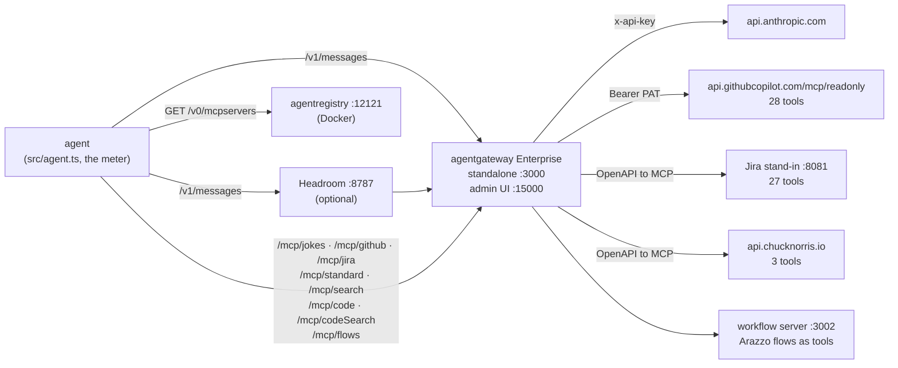

# MCP context bloat demo

An agent that uses MCP tools pays for every tool definition on every model call, whether the task needs it or not. This repo lets you watch that happen, then fix it four ways with the [Solo.io](https://solo.io) agentic stack:

1. **Build and bloat.** An agent with a jokes MCP server, then GitHub, then Jira. The same one-line request costs more and more.
2. **Just in time.** [agentregistry](https://github.com/agentregistry-dev/agentregistry) holds the catalog. The agent looks servers up and connects only to what the task needs.
3. **Compress.** [Headroom](https://github.com/headroomlabs-ai/headroom), a local proxy, compresses what still comes back before it reaches the model.
4. **Tool modes.** All servers behind one [agentgateway](https://agentgateway.dev) endpoint, presented as `standard`, `search`, `code` or `codeSearch`.
5. **Flows (optional).** A multi-step API flow written once as an [Arazzo](https://spec.openapis.org/arazzo/latest.html) workflow and served as a single tool.

It backs the talk *The MCP token tax* (the deck marks where each demo fits), but each stage runs on its own. Everything runs on one machine, **with no Kubernetes**: one gateway binary, two Node processes, one optional Python process, and Docker only for the registry.

It follows the layout of [kong-mcp-gateway-examples](https://github.com/hguerrero/kong-mcp-gateway-examples) and builds on `mcp-toolmodes` and `headroom` in [agentgateway-examples](https://github.com/hguerrero/agentgateway-examples).

## The meter

Every run prints one block, so you can compare stages at a glance:

```
Stage 3: + Jira MCP (all connected up front)
  model claude-haiku-5-5 via gateway   tools in context: 58  (jokes 3, github 28, jira 27)
  prompt: Tell me a Chuck Norris joke.

  call  1  in  16,482  out   27  4.8s  -> getJoke
  call  2  in  16,696  out   33  4.4s  -> answer

  ┌───────────────────── METER ─────────────────────
  │ tools in context   58   (catalog ≈ 16,430 tokens)
  │ model calls        2   (tool calls: 1)
  │ input tokens       33,178
  │ output tokens      60
  │ latency            10.8s total   (9.1s model, 0.6s tools)
  │ cost               $0.0335
  └─────────────────────────────────────────────────
```

## Architecture



The model calls go through the gateway too, so the gateway holds both secrets and logs both kinds of traffic.

## Repository structure

```
mcp-context-bloat-demo/
├── gateway/
│   ├── config.yaml            # model route, 3 MCP routes, 4 tool-mode routes, flows route
│   └── openapi-chuck.yaml     # jokes API, converted to MCP tools by the gateway
├── mocks/jira/                # Jira stand-in: 27 operations (spec.mjs), server.mjs, generated openapi.json
├── registry/
│   ├── docker-compose.yaml    # agentregistry + Postgres (catalog only)
│   └── servers.yaml           # 18 MCP servers: the 3 real ones and 15 decoys
├── flows/
│   ├── release-brief.arazzo.yaml   # the workflow
│   ├── openapi/github-rest.yaml    # one GitHub REST operation, for the workflow
│   └── server.ts                   # serves each workflow as an MCP tool (@usearazzo/runner)
├── src/
│   ├── lib.ts                 # stages, MCP client, registry lookup, the agent loop and the meter
│   ├── agent.ts               # run one stage
│   ├── compare.ts             # run several stages and print one table
│   └── census.ts              # list the tools each endpoint exposes (no model call)
├── scripts/
│   ├── up.sh · down.sh        # gateway, Jira stand-in, workflow server
│   ├── registry-up.sh · registry-down.sh
│   ├── run-headroom.sh        # installs and starts Headroom (optional)
│   └── demo.sh                # presenter script, one entry per demo in the deck
└── docs/sample-results.md     # the numbers from the reference run (fallback for a live demo)
```

## Prerequisites

| Need | Why |
|---|---|
| Solo Enterprise agentgateway and its license key | `toolMode` (`search`, `code`, `codeSearch`) is an Enterprise feature. The open-source proxy (v1.7.0 checked) rejects `toolMode` as an unknown field, so `gateway/config.yaml` does not load there. Stages 0 to 4 and 6 only use the first routes, so you can delete the three tool-mode routes (`/mcp/search`, `/mcp/code`, `/mcp/codeSearch`) and the `toolMode: standard` line, and run them on the open-source proxy (the trimmed config validates on v1.7.0; I did not run the stages on it). |
| Anthropic API key | The model calls. A full pass over every stage costs well under $1 with `claude-haiku-5-5`. |
| GitHub token | Read-only. GitHub's hosted MCP server needs one, even for public repositories. If `GITHUB_PAT` is empty, the scripts use `gh auth token`. |
| Node.js 20.10+ | The agent, the Jira stand-in and the workflow server |
| Docker with Compose v2 | agentregistry only (stages 4) |
| Python 3.10+ | Headroom only (stage 3). The script installs it into `./.venv`. |
| macOS (Apple Silicon) or Linux | The Enterprise standalone binary |

## Quick start

```bash
# 1. Install the Enterprise proxy (versions look like v2026.10.0; the open-source proxy is 1.x)
curl -fsSL https://run.solo.io/agentgateway/install | sh
~/.agentgateway/bin/agentgateway --version

# 2. Configure
cp .env.example .env        # fill in AGENTGATEWAY_LICENSE_KEY and ANTHROPIC_API_KEY
npm install

# 3. Start the gateway, the Jira stand-in and the workflow server
./scripts/up.sh             # admin UI: http://localhost:15000/ui

# 4. Start the registry and load its catalog (stage 4)
./scripts/registry-up.sh    # UI: http://localhost:12121

# 5. Check, then run
./scripts/demo.sh check
npm run census              # what each endpoint exposes, no model call
npm run agent -- --stage jira
```

Stop everything with `./scripts/down.sh` and `./scripts/registry-down.sh`.

## The stages

Two tasks run through every stage, so the numbers are comparable:

| Task | Prompt | Needs |
|---|---|---|
| `joke` (default) | Tell me a Chuck Norris joke. | the jokes server |
| `github` | What is the latest release of agentgateway/agentgateway, and when was it published? | GitHub |
| `release` | The latest release of agentgateway/agentgateway, how many issues in the Jira project AGW are not done, and a joke. | all three servers |

```bash
npm run agent -- --stage <stage> --task <joke|github|release> [--headroom] ["or any free-text prompt"]
```

| Stage | What the agent has | Try |
|---|---|---|
| `bare` | no tools | `npm run agent -- --stage bare` |
| `jokes` | the jokes MCP (3 tools) | `npm run agent -- --stage jokes` |
| `github` | + GitHub (31 tools) | `npm run agent -- --stage github` |
| `jira` | + Jira (58 tools), connected up front | `npm run agent -- --stage jira` |
| `registry` | two registry tools, servers loaded on demand | `npm run agent -- --stage registry --task joke` |
| `standard` `search` `code` `codeSearch` | one endpoint, one tool mode each | `npm run agent -- --stage codeSearch --task release` |
| `flows` | one tool per Arazzo workflow | `npm run agent -- --stage flows --task release` |

Add `--headroom` to send the model calls through Headroom (start `./scripts/run-headroom.sh` first). To compare stages in one table:

```bash
STAGES=bare,jokes,github,jira npm run compare                         # the bloat
STAGES=jira,registry TASK=joke npm run compare                        # just in time
STAGES=standard,search,code,codeSearch TASK=release npm run compare   # the tool modes
STAGES=jira,search,codeSearch HEADROOM=off,on TASK=release npm run compare
RUNS=3 STAGES=standard,codeSearch TASK=release npm run compare        # median of 3 runs
```

### 1. Build and bloat

`jokes` is 3 tools from an OpenAPI spec. GitHub's hosted MCP server adds 28 read-only tools and the Jira stand-in adds 27. The request does not change, and the first model call grows from about 50 input tokens (no tools) to about 16,000. `./scripts/demo.sh 1` runs the four stages with a pause between them.

### 2. Just in time with agentregistry

The agent starts with two tools, `find_mcp_servers` and `connect_mcp_server`. The registry (`GET /v0/mcpservers`) holds 18 servers with a title, a description and a URL (the gateway route). The agent looks one up, connects, and its tools appear on the next turn.

Ranking here is a keyword score in the agent. The registry stores the catalog and its metadata, and embeddings over the same records would make it semantic. The registry unit is a **server**, so it pays when a task touches few servers (`joke`, `github`) and does not pay when one task needs all of them (`release`).

Add or change servers with `registry/servers.yaml`, then re-run `./scripts/registry-up.sh` (or `arctl apply -f`).

### 3. Compression with Headroom

Headroom sits between the agent and the gateway's `/v1/messages` and compresses the request body. It acts on data, not on the catalog, so it does little on small tool results. The script starts it lossy (`--no-ccr`, because an injected retrieval tool breaks MCP tool calling). Set `HEADROOM_LOSSLESS=1` for lossless compaction. See [headroom](https://github.com/hguerrero/agentgateway-examples/tree/main/headroom) for a full matrix with an answer-quality judge. Its finding applies here: lossy compression can drop items from big lists.

### 4. Tool modes

The three servers sit behind `/mcp/standard`. The other three routes present the same tools differently:

| Route | `toolMode` | The model sees |
|---|---|---|
| `/mcp/standard` | `standard` | all 58 tools with their schemas |
| `/mcp/search` | `search` | `get_tool`, `invoke_tool` |
| `/mcp/code` | `code` | `run_code`, with the JavaScript API for all 58 tools in its description |
| `/mcp/codeSearch` | `codeSearch` | `get_tool`, `run_code` (no API in the description) |

`./scripts/demo.sh 4` runs the four modes on the `release` task and prints one table. Try a mode by hand, with no model:

```bash
rpc() { curl -s -X POST localhost:3000/mcp/$1 -H 'Content-Type: application/json' -H 'Accept: application/json, text/event-stream' -d "$2" | sed 's/^data: //' | grep '^{'; }
rpc search '{"jsonrpc":"2.0","id":1,"method":"tools/call","params":{"name":"get_tool","arguments":{"name":"github_get_latest_release"}}}'
rpc code '{"jsonrpc":"2.0","id":2,"method":"tools/call","params":{"name":"run_code","arguments":{"code":"const j = await jokes_getJoke({}); j.value"}}}'
```

`code` and `codeSearch` run scripts in a sandbox with `timeout: 30s` and `cpuTimeout: 1s` (see `gateway/config.yaml`). Tool modes do not replace authorization: put `mcpAuthorization` rules on the routes as in the `mcp-acls` example.

### 5. Flows (optional)

`flows/release-brief.arazzo.yaml` describes three steps (GitHub release, Jira search, joke). `flows/server.ts` loads it with [`@usearazzo/runner`](https://www.npmjs.com/package/@usearazzo/runner) (an alpha release) and serves each workflow as one MCP tool, behind the gateway at `/mcp/flows`. The agent makes one call. The flow is fixed, so the agent cannot adapt it, and Arazzo was not designed for LLM use. The runner is early: it does not interpolate an embedded expression such as `{$inputs.project}` inside a string, so the workflow takes the whole JQL as an input. Treat this as a pattern to evaluate, not a recommendation.

## Results

[`docs/sample-results.md`](docs/sample-results.md) has the tables from the reference run (`claude-haiku-5-5`, median of 3 to 5 runs, no prompt caching). Use them as a fallback if a live run fails. Your numbers will differ: the model picks its own steps, and run-to-run variation is real.

What the reference run showed:

- **The bloat is large.** The first model call of the same one-line request costs 52 input tokens with no tools and about 16,500 with the three servers (58 tools).
- **Just in time pays when a task touches few servers.** -88% on the joke, -12% on a GitHub-only question, and +5% on the task that needs all three servers.
- **Search shrinks the catalog, not the payload.** `search` cut about 45% of the input tokens on the `release` task, because the roughly 25,000-token GitHub release still passes through the model. It also had the widest spread.
- **`code` alone saves by collapsing calls, not by shrinking the catalog.** Its description carries the API for all 58 tools (about 14,600 tokens): -49%.
- **`codeSearch` saved the most (-88%) but depends on the script.** Without `CODE_HINT=1`, 3 of 5 runs returned the raw release from `run_code` and cost about 62,000 tokens instead of 6,800.
- **Headroom did little here.** The tool results were small and one big payload dominates. Do not read the `codeSearch` pair as a Headroom effect.
- **Flows were cheapest (-97%)** because the order of the calls is fixed in the workflow.

## Options

| Variable | Default | What it does |
|---|---|---|
| `MODEL` | `claude-haiku-5-5` | The model. Set `PRICE_INPUT` and `PRICE_OUTPUT` (USD per million tokens) for models the agent does not know. |
| `CODE_HINT` | unset | `1` adds one sentence to the system prompt: filter inside scripts and return only what the question asks for. Without it, `code` and `codeSearch` sometimes return a whole raw tool result from `run_code`, which puts the payload back in the context. `demo.sh` sets it for the tool-mode demos. |
| `EFFORT` | `low` | `output_config.effort`. Set `off` to omit it. |
| `STAGES`, `TASK`, `RUNS`, `HEADROOM` | see above | For `npm run compare` |
| `DELAY_MS` | `3000` | Pause between runs in `compare`, so GitHub's hosted MCP server does not rate-limit you |
| `GATEWAY_URL`, `REGISTRY_URL`, `HEADROOM_URL` | `localhost` ports above | Where each service listens |
| `AGENTREGISTRY_VERSION` | `v0.4.0` | The registry image tag |
| `AGENTGATEWAY_BIN` | `~/.agentgateway/bin/agentgateway` | The gateway binary |

Each run is saved to `results/` (ignored by git), with every call, the `run_code` scripts and the answer.

## Scope and safety

1. **Read-only by construction.** GitHub's upstream path is `/mcp/readonly`: `get_*`, `list_*` and `search_*` tools only. Do not change it to `/mcp/all/readonly`, which also lists write tools. The Jira stand-in has write operations, but it changes only an in-memory copy of canned data.
2. **Scope the token.** Use a fine-grained read-only GitHub token. Repositories are named in the prompt, not enforced.
3. **The model writes the code** in `code` and `codeSearch`. Keep the sandbox limits low and treat script results like any tool result.
4. **Headroom runs on your machine** and compresses locally. It downloads a model from Hugging Face on first start. The script turns off its usage beacon.
5. **Secrets stay out of git.** The gateway reads `GITHUB_PAT`, `ANTHROPIC_API_KEY` and the license from the environment. `.env`, `results/`, `.run/` and `.venv/` are ignored.
6. **The registry runs without the Docker socket or kubeconfig.** The upstream compose file mounts both for deployments, which this demo does not use.

## Troubleshooting

| Symptom | Check |
|---|---|
| The proxy does not start | The license is missing or invalid. `curl -s localhost:15000/api/runtime \| jq .license` shows the loaded license. |
| `up.sh` says the binary is not the Enterprise build | `agentgateway` on your `PATH` is the open-source `1.x` proxy. Use `~/.agentgateway/bin/agentgateway` or set `AGENTGATEWAY_BIN`. |
| The agent stops with "not what stage ... should expose" | A tool-mode route is in the wrong mode. Check that you run the Enterprise proxy with this config. |
| `429 too many requests` | GitHub's hosted MCP server rate-limits bursts. The agent retries with a pause. Raise `DELAY_MS` and keep `RUNS` low. |
| `unknown service get` (or `invoke`, `run`) from a tool-mode route | The route has more than one target. On Enterprise v2026.10.0 a tool mode needs a route with one target. This repo fronts the federated `/mcp/standard` route for that reason. See the comment in `gateway/config.yaml`. |
| `503 backends required DNS resolution which failed` | If the gateway just started, wait a few seconds. If it persists, uncomment `config.dns.lookupFamily: V4Only` in `gateway/config.yaml`. |
| `registry answered ...` | Start it with `./scripts/registry-up.sh` and check that port 12121 is free. |
| Headroom ON equals OFF | Check that Headroom was not started with `--no-optimize`. The agent sends the calls to `HEADROOM_URL` only with `--headroom`. |
| `Address already in use` | Another process holds 3000, 8081, 3002, 15000, 12121 or 8787. |

## Resources

- [agentgateway](https://agentgateway.dev) and the [tool modes docs](https://docs.solo.io/agentgateway/standalone/latest/documentation/mcp/tool-mode/)
- [agentregistry](https://github.com/agentregistry-dev/agentregistry)
- [Headroom](https://github.com/headroomlabs-ai/headroom)
- [Arazzo specification](https://spec.openapis.org/arazzo/latest.html) and [@usearazzo/runner](https://www.npmjs.com/package/@usearazzo/runner)
- [agentgateway-examples](https://github.com/hguerrero/agentgateway-examples): `mcp-toolmodes`, `headroom`, `mcp-acls`
- [kong-mcp-gateway-examples](https://github.com/hguerrero/kong-mcp-gateway-examples): the Kong version of the registry demo

## License

Licensed under the Apache License, Version 2.0.
